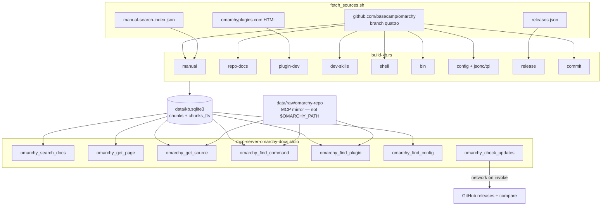
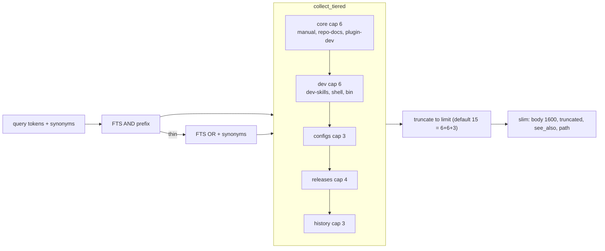
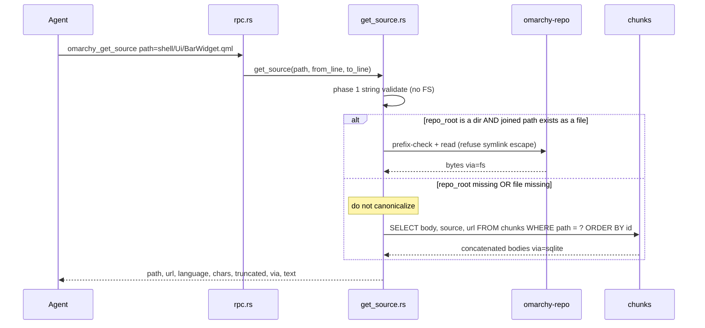
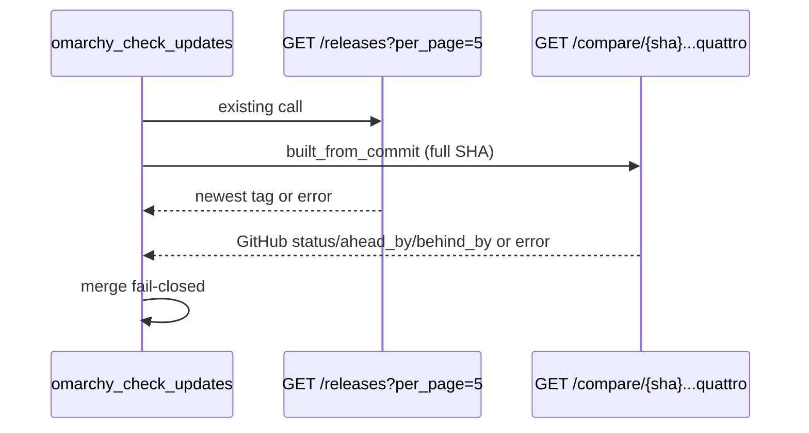

# Make mcp-server-omarchy-docs useful for Omarchy development

| Field | Value |
|---|---|
| **Author** | mcp-server-omarchy-docs maintainers |
| **Date** | 2026-08-24 |
| **Status** | Ready for implementation |
| **Audience** | Maintainers of `mcp-server-omarchy-docs` (Rust MCP server) |
| **Repo** | `/run/media/codechap/4TB/develop/mcps/mcp-server-omarchy-docs` |
| **Companion** | Offline JSON-RPC/stdio MCP server; SQLite FTS5 KB rebuilt by `server-rs/src/bin/build-kb.rs` |

---

## Overview

`mcp-server-omarchy-docs` is an offline Rust MCP server that indexes Omarchy documentation into SQLite FTS5 and serves it over newline-delimited JSON-RPC. After the last quattro refresh the live KB holds **6242 chunks** (`commit` 5663, `release` 201, `manual` 186, `config` 109, `repo-docs` 67, `plugin-dev` 16), pinned at **latest_release v4.0.0** and **built_from_commit `b5ded31e2f9a`**. The clone at `data/raw/omarchy-repo` is branch **`quattro`** at `b5ded31e` — GitHub `origin/HEAD` is `quattro`, not `master`.

That KB is an **end-user/docs searcher**. Omarchy-dev work (plugins, shell QML, CLI, contributor skills) needs the files Omarchy itself treats as the contract — `AGENTS.md`, `agents/skills/*.md`, `shell/**`, `bin/omarchy-*` — which sit in the clone and are never ingested. `omarchy_get_page` only reconstructs prose sources (`manual`, `repo-docs`, `plugin-dev`). `omarchy_check_updates` compares GitHub **release tags** only, so quattro branch drift is invisible. Several advertised `source_filter` values are silently ignored.

This design adds three first-class sources (`dev-skills`, `shell`, `bin`), a `dev` search tier so contract files rank next to tutorials, three new tools (`omarchy_get_source`, `omarchy_find_command`, `omarchy_find_plugin`), and a tight set of fixes to existing tools. Search stays a **locator** (wire `BODY_CAP` 1600 + `truncated: true`); `get_source` is the **reader**; `get_page` stays the prose reader. Query-time I/O is the **MCP fetch_sources mirror** (`data/raw/omarchy-repo`) plus sqlite — not `$OMARCHY_PATH` / the user’s dirty tree. Query time remains offline except `omarchy_check_updates`. No new crates. `build-kb` still recreates `data/kb.sqlite3` from scratch. **New binary + old DB is unsupported** (FTS arity); ship them together.

Expected ingest delta: **~630 chunks / ~2.4 MB of UTF-8** versus 5663 commit rows already stored (~10% more rows, sqlite from 4.7 MB to ~7 MB). FTS over ~6900 rows stays sub-millisecond.

---

## Background & Motivation

### Current state (verified)

`server-rs/src/bin/build-kb.rs` ingests:

| Source | Glob today | Notes |
|---|---|---|
| `manual` | `manual/*.md` (non-recursive) | H2-split; live omarchy.org URLs from `data/raw/manual-search-index.json` |
| `repo-docs` | `docs/*.md` (non-recursive) | H2-split; URL incorrectly uses `tree/master/` |
| `plugin-dev` | `data/raw/omarchyplugins/{develop,publish}.html` | HTML→markdown supplement |
| `config` | `config/`, `default/`, `etc/` with `CONFIG_EXTS` | No `.qml`, `.js`, `.md`, `.jsonc`, `.tpl`; no extensionless files |
| `release` | `data/raw/releases.json` | GitHub release notes |
| `commit` | `git log --no-merges` messages | Not blobs |

`CONFIG_EXTS` (`build-kb.rs` lines 56–59):

```text
.conf .ini .toml .kdl .css .rasi .json .sh .bash .zsh .lua
```

So `default/themed/*.tpl`, `default/omarchy/omarchy-menu.jsonc`, `etc/fastfetch/config.jsonc`, and `default/agents/skills/**/*.md` are skipped.

### What the clone actually contains (HEAD `b5ded31e`, branch `quattro`)

| Tree | Count | Why it matters |
|---|---:|---|
| `shell/**/*.qml` | 95 | Host + plugins; `shell/Ui/BarWidget.qml` is the bar-widget base |
| `shell/**/*.js` | 27 | Models (`BarModel.js`, `MenuModel.js`, …) |
| `shell/**/manifest.json` + `*.manifest.json` | 37 | First-party plugin contract (`id`, `kinds`, `entryPoints`) |
| `shell/**/*.md` | 5 | `shell/README.md`, `shell/plugins/README.md`, per-plugin READMEs |
| `bin/` | 436 | 435 `omarchy-*` scripts (all have `# omarchy:summary=`) + `bin/omarchy` (the router). Not 436 `omarchy-*`. |
| `agents/skills/*.md` | 7 | Contributor procedures AGENTS.md tells agents to read first |
| `AGENTS.md` | 1 | Contributor index (~7.8 KB) |
| `default/agents/skills/**/*.md` | 9 | End-user skill pack (out of v1; see Non-Goals) |
| `test/shell.d` | ~206 | Do **not** dump into core |
| `migrations/` | 88 | Out of v1 |
| `install/` | 83 | Out of v1 |

Omarchy’s own docs split the trees by audience (`AGENTS.md` “Documentation Layout”):

- `agents/skills/` — task procedure for anyone working on the codebase
- `docs/` — reference on how the system is shaped
- `manual/` — end-user documentation; never codebase internals

The MCP server currently indexes the last two plus marketplace HTML, and treats `bin/` / `shell/` as an escalation step (“go read GitHub”). That is the opposite of what an Omarchy-dev agent needs.

### Pain points in the live tools

From `server-rs/src/tools.rs`, `rpc.rs`, `kb/search.rs`, `kb/pages.rs`, `kb/updates.rs`:

1. **`source_filter=manual` searches the entire core tier.** `search.rs` maps `Some("manual") | Some("docs") => &TIERS[0..1]`, and `TIERS[0]` is `["manual", "repo-docs", "plugin-dev"]`.
2. **`source_filter=commit` and `repo-docs` fall through to `_ => TIERS`** and are silently ignored. They are not even in the advertised enum (`tools.rs` allows `omarchy | manual | plugin-dev | config | release`).
3. **`see_also` is computed and dropped.** `attach_upstream_links` fills `Rec.see_also` from `data/upstream_map.json`; `rpc.rs` `slim()` never serializes it. Playbook L2 claims search results attach curated upstream links.
4. **Search bodies are silently clipped.** `BODY_CAP` 1600 plus an ellipsis character; no `truncated` flag (unlike `format_release`, which already emits `"truncated": bool`).
5. **Escalation only when `results.len() < 2`.** Fine for empty queries; a 2-hit miss still looks “successful.”
6. **`omarchy_get_page` cannot open `.qml` / `bin/` scripts.** `page_by_title` / `all_page_titles` restrict `source IN ('manual','repo-docs','plugin-dev')`. After we ingest shell/bin, a path query such as `shell/Ui/BarWidget.qml` can match a title via unfiltered `titles_matching_path` and then fail in `page_by_title` with `No page titled '…'`.
7. **Schema vs runtime mismatch.** `limit` advertised `maximum: 20`; `handle_call` clamps `1..=1000`.
8. **`omarchy_check_updates` misses quattro drift.** It GETs `/repos/basecamp/omarchy/releases?per_page=5` and compares `meta.latest_release`. Clone HEAD can move for days without a new tag.
9. **Stale strings.** `AGENT_PLAYBOOK.md` and `REFRESH.md` still mention `build_kb.py`; `main.rs` logs “Run scripts/build_kb.py first.”
10. **Stale MCP clients.** `tools/list` grew `plugin-dev` already; hosts that cache the tool schema at first connect will not see new tools until reconnect. Bump `SERVER_VERSION` (and `Cargo.toml` `version`) **when `tools/list` changes**, not on ingest-only PR1.

### Why plugin-dev HTML is not enough

`plugin-dev` is a marketplace tutorial (clone, manifest kinds, a BarWidget example, validate/publish). It does not replace:

- `shell/services/PluginRegistry.qml` — `validateManifest`, `isEnabled`, `clonedFrom` routing
- `shell/Ui/BarWidget.qml` — injected `bar` / `moduleName` / `settings`, `setting()`, `broadcast()`
- `bin/omarchy-plugin-catalog` — first-party + user manifest walk (`mindepth 2 / maxdepth 4`)
- `bin/omarchy-plugin-clone` — copy rules, `omarchy.clonePaths`, username-prefixed ids
- `agents/skills/shell-dev.md` / `docs/omarchy-shell.md` — contributor contract

`plugin-dev` stays a **supplement** in the `core` tier. It must not be the only plugin hit.

---

## Goals & Non-Goals

### Goals (v1 — this slice)

1. Ingest `agents/skills`, `AGENTS.md`, `shell/` (QML/JS/manifests/READMEs/qmldir/small helpers), and `bin/` as first-class sources `dev-skills`, `shell`, `bin`.
2. Add `omarchy_get_source` — full UTF-8 file from the **MCP mirror** (sqlite fallback) by repo-relative path. Not `$OMARCHY_PATH`.
3. Add `omarchy_find_command` — resolve via filename + `# omarchy:group/summary/args` (same rules as `docs/cli-router.md` / `agents/skills/command-metadata.md` / `bin/omarchy`).
4. Add `omarchy_find_plugin` — same first-party walk as `bin/omarchy-plugin-catalog` (not user `~/.config/omarchy/plugins`).
5. Fix existing tools: honor `source_filter` for `commit`, `repo-docs`, `manual` (manual ≠ whole core), serialize `see_also`, emit `truncated: true`, compare `built_from_commit` to origin/quattro, add dev synonyms, ingest `.jsonc` and `.tpl`.
6. Point docs/playbook/README at the new tools; replace `build_kb.py` leftovers.

### Non-Goals (v1)

- Ingesting `test/` (including `test/shell.d` ~204 tests), `migrations/`, `install/`, `plans/`, `themes/`. A later filterable `tests` source is allowed if cheap; not this slice.
- Ingesting `default/agents/skills/omarchy/*` (end-user skill pack). **User decision (final):** follow-up, not v1. Distinct audience from contributor `agents/skills/`. Later candidate: source `user-skills` in the `configs` tier (~9 files / 35 KB).
- Semantic search, embeddings, extra crates, Docker, Python.
- Scanning the **user’s** `~/.config/omarchy/plugins/` (catalog does; this KB is upstream).
- Changing the MCP transport (stdio JSON-RPC stays).
- Schema migrations of existing DBs. `build-kb` already `unlink`s `data/kb.sqlite3`.
- Directory listing via `get_source` (v1 is files only).
- Executing `omarchy commands` / `jq` / bash at query time.
- Raising **search-wire** `BODY_CAP` above 1600 (ingest `BODY_CAP` does rise to 200_000 so snapshot `get_source` is complete for current files).
- Reading `$OMARCHY_PATH`, `~/.local/share/omarchy`, or the user’s live checkout. **User decision (final):** v1 is the MCP fetch_sources mirror + sqlite only. No `--repo` override in this slice.
- A “list all commands / all plugins” mode on `find_command` / `find_plugin` (`query` is required).

---

## Key Decisions

1. **Source names `dev-skills`, `shell`, `bin` — not folded into `repo-docs`.** `repo-docs` is `docs/*.md` (how the system is shaped). Mixing QML and CLI into it would make `source_filter=repo-docs` meaningless. Names stay distinguishable.

2. **New `dev` tier between `core` and `configs`, cap 6, default search `limit` 15.** Putting ~630 source files *into* `core` (cap 6) would let five `BarWidget.qml` copies starve `plugin-dev` and `docs/omarchy-shell.md`. A dedicated `dev` tier keeps tutorials first and contract files immediately after. Caps are core 6 + dev 6 + configs 3. Default `limit` must be **≥ 15** so a fat AND pass is `6+6+3` and **`hyprland` still surfaces `hypr/hyprland.lua`**. `limit` 12 would be exactly 6+6 and would silently drop the `configs` tier — a user-visible regression versus today (limit 8 → 6 core + 2 configs). Releases/history still need `source_filter` or a higher `limit`, as they already do.

3. **Search is a locator; `get_source` is the reader; `get_page` stays prose.** Search bodies stay 1600 chars with `truncated: true`. `get_page` allowlist remains `manual` / `repo-docs` / `plugin-dev`, plus `dev-skills` (they are markdown chapters). Code, manifests, and scripts go through `get_source`.

4. **`get_source` / `find_*` read the MCP fetch_sources mirror, then sqlite — never `$OMARCHY_PATH`.** **User decision (final):** v1 has **no** `$OMARCHY_PATH` / `--repo` override. `repo_root` is `data/raw/omarchy-repo` next to `kb.sqlite3`. That is **upstream-as-indexed**, not the files an Omarchy-dev agent is editing under `omarchy dev link`. Weekly `kb` release ships **only** `data/kb.sqlite3`; snapshot-only installs have no clone directory. Query-time algorithm: (1) validate the path **string** with no filesystem calls; (2) if `repo_root` exists **and** the joined file exists, prefix-check + read; (3) otherwise sqlite. Never `canonicalize()` a missing path. Success payload always includes `"via": "fs"|"sqlite"`.

5. **No extra SQL tables. Shared `command_meta.rs` is required, not optional.** Command metadata and plugin manifests are parsed at query time from **original file bytes** (clone) or chunk `body` (sqlite). Do **not** prepend a `ROUTE:`/`SUMMARY:` block to `body` — `bin/omarchy` stops at the first non-comment line, so that prefix would make the sqlite fallback lose `summary`/`args`/`hidden`. Ingest `body` is the file (capped at 200_000 chars). Route tokens are searchable via filename title (unicode61 splits hyphens) plus `section` = metadata group. Parser lives in `server-rs/src/command_meta.rs`, compiled into both binaries (`mod command_meta` from `main.rs`; `#[path = "../command_meta.rs"]` from `build-kb.rs`).

6. **Add `path` to FTS5 as the fourth column (recreate-only); search SQL must change in the same PR.** Frozen order: `title, section, body, path`. `bm25(chunks_fts, 6.0, 3.0, 1.0, 4.0)`; `highlight(chunks_fts, 2, …)` stays on body. **New binary + old 3-column DB is unsupported**: extra bm25 arguments can make `prepare` fail, and `kb::query` swallows that into `[]` — **all search can go silently empty**, not merely empty `shell` filters. Pairing binary and `kb.sqlite3` is a hard release constraint. Title stays the human name (`BarWidget.qml`, `omarchy-plugin-clone`, H1 for markdown); we do **not** stuff path into title (that remains the config-ingest workaround we are replacing).

7. **Per-file chunks for code/manifests/scripts; H2-split only for markdown.** QML has no `##` contract. One file = one locator row. Markdown (`AGENTS.md`, skills, shell READMEs) still uses `split_sections`.

8. **GitHub file URLs use `blob/quattro/<path>`, not `blob/{sha}/`.** Clone `origin/HEAD` is `quattro`. Existing `ingest_repo_docs` URLs `tree/master/` are wrong and get fixed in the same ingest change. Mixed freshness is **intentional**: FTS `body` is the snapshot; blob URLs and (when present) the clone working tree track the quattro branch HEAD after the last fetch. Agents clicking through land on the branch they develop against. `kb_info.built_from_commit` is the SHA that was indexed.

9. **Skip binaries, fonts, images, and `shell/plugins/emojis/emojis.json` (108 KB of emoji payload).** UTF-8 probe on first 4 KiB (same as config ingest). Max file size 200 KiB (`CONFIG_MAX_BYTES`).

10. **`plugin-dev` HTML stays a supplement.** It does not replace `PluginRegistry.qml` or `bin/omarchy-plugin-clone`.

11. **`omarchy_find_plugin` is first-party only.** Mirror catalog’s `shell/plugins` walk (`mindepth 2`, `maxdepth 4`, `manifest.json` + `*.manifest.json`). Do not walk `$HOME/.config/omarchy/plugins`.

12. **`omarchy_check_updates` compares release tags *and* `built_from_commit...quattro`, fail-closed on both calls.** Two GitHub GETs on invoke only (still the sole networked tool). GitHub compare `{base}...{head}` reports `ahead_by` / `behind_by` **from the head’s point of view**. For `{local}...quattro`, “quattro moved” is `status=ahead`, `ahead_by=N`, `behind_by=0`. Map `commits_behind_quattro = ahead_by`. **Never emit `UP TO DATE` unless both calls succeed and both say current.** Compare failure → `quattro_compare: "error"|"unavailable"` and overall `UNKNOWN — could not compare quattro` (unless tags already prove OUTDATED).

13. **Clamp `limit` to the advertised schema (1–20).** Stop claiming max 20 and accepting 1000. Default 15.

14. **Bump `SERVER_VERSION` when tools/list changes, in lockstep with `Cargo.toml` `version`.** PR1 (ingest only, same seven tools) stays `1.0.0`. PR2 (`get_source`) → `1.1.0`. PR3 (`find_*`) → `1.2.0`. Hosts that cache schemas keyed on `serverInfo.version` then reconnect. Document reconnect anyway.

15. **100% Rust, rusqlite bundled FTS5, no new heavy deps.** Metadata/manifest parsing is a few dozen lines of string/JSON work (`serde_json` already in tree). Do not shell out to `jq` or `omarchy`.

16. **v1 does not ingest tests/migrations/install/themes/plans or the end-user skill pack.** **User decision (final):** `default/agents/skills/**` stays a follow-up (`user-skills` in the `configs` tier), not this slice.

17. **`source_filter=manual` is a breaking-but-correct semantic change.** Today it searches all of core (`manual`+`repo-docs`+`plugin-dev`). After PR1 it is the end-user manual only. Clients that wanted today’s mix pass `docs` or omit the filter. Unknown enum values still fall through to all tiers — that helps **new** clients on an **old** server, not old clients (they never send `shell`).

18. **`source_filter=docs` is prose-only: `manual` + `repo-docs` + `plugin-dev`.** **User decision (final):** it does **not** include `dev-skills`. Contributor skills stay on `source_filter=dev-skills` or the default (all tiers) / `dev`.

---

## Proposed Design

### Architecture



### Search tiers after this change



`server-rs/src/kb/mod.rs` becomes:

```rust
pub(crate) const TIERS: &[(&str, &[&str])] = &[
    ("core",      &["manual", "repo-docs", "plugin-dev"]),
    ("dev",       &["dev-skills", "shell", "bin"]),
    ("configs",   &["config"]),
    ("releases",  &["release"]),
    ("history",   &["commit"]),
];

pub(crate) const OMARCHY_TIERS: &[(&str, &[&str])] =
    &[("core", &["manual", "repo-docs", "plugin-dev"]), ("releases", &["release"])];

pub(crate) fn tier_limit(tier: &str) -> usize {
    match tier {
        "core" => 6,
        "dev" => 6,
        "configs" => 3,
        "releases" => 4,
        _ => 3,
    }
}
```

`source_filter=omarchy` stays **user-facing prose** (manual + repo-docs + plugin-dev + releases). It does **not** pull `shell`/`bin`. Dev agents use the default (all tiers) or an explicit `shell` / `bin` / `dev-skills` filter. End-user agents that previously passed `source_filter=manual` to mean “docs, not configs” must switch to `docs` or omit the filter — `manual` becomes manual-only.

Default `limit` in `rpc.rs` / `tools.rs`: **15** (was 8). Composition of a full AND pass: 6 core + 6 dev + 3 configs. Schema `maximum` stays 20; runtime clamp **1–20** (was 1–1000). Protocol test: default `hyprland` search still includes a `source=config` hit.

### Ingest: new sources

All new ingest lives in `server-rs/src/bin/build-kb.rs`. `main()` gains three calls after `ingest_plugin_guides` and before `ingest_configs`:

```rust
ing.ingest_dev_skills(&repo);
ing.ingest_shell(&repo);
ing.ingest_bin(&repo);
```

Shared constants (next to existing `CONFIG_MAX_BYTES` / `BODY_CAP`):

```rust
const GITHUB_BLOB: &str = "https://github.com/basecamp/omarchy/blob/quattro/";
const SOURCE_MAX_BYTES: u64 = 200_000; // same as CONFIG_MAX_BYTES
const BODY_CAP: usize = 200_000;       // was 50_000; sqlite get_source must be complete for current max files (~94 KB)

const SKIP_EXTS: &[&str] = &[
    ".svg", ".png", ".webp", ".gif", ".jpg", ".jpeg",
    ".ttf", ".otf", ".woff", ".woff2", ".eot",
    ".ico", ".bin", ".wasm",
];

const SKIP_NAMES: &[&str] = &["emojis.json"]; // 107,827 B payload, not contract
```

URL helper (also used to **fix** `ingest_repo_docs`, which currently emits `tree/master/`):

```rust
fn github_blob(rel: &str) -> String {
    format!("{GITHUB_BLOB}{rel}")
}
```

UTF-8 / size gate is the existing config probe: skip if `metadata.len() > SOURCE_MAX_BYTES`, skip if first 4 KiB is not UTF-8, skip empty.

#### `dev-skills`

| | |
|---|---|
| **Files** | `AGENTS.md`; `agents/skills/*.md` (flat today: 7 files). Skip `CLAUDE.md` (`@AGENTS.md`, 11 bytes of noise). |
| **Split** | `clean_markdown` + `split_sections` (same as manual/repo-docs) |
| **title** | H1 / `find_h1`, else stem (`AGENTS`, `command-metadata`) |
| **section** | H2 title |
| **path** | repo-relative (`agents/skills/shell-dev.md`) |
| **url** | `github_blob(rel)` |
| **priority** | 1 |
| **Est. chunks** | ~25–40 (AGENTS.md has 12 H2s; skills are short) |

Do not recurse into `default/agents/skills/` here.

#### `shell`

Walk `shell/` with existing `walk_scandir`. **Skip non-files** (`walk_scandir` pushes directories as well as files; config ingest only survives because `fs::read` on a dir fails — do not rely on that).

**Include**

- Extensions: `.qml`, `.js`, `.md`, `.json`, `.sh`, `.py`
- Extensionless names: `qmldir` (`shell/Ui/qmldir`, `shell/Commons/qmldir` — QML module contract)

**Skip**

- `SKIP_EXTS` (the 4 SVGs under `shell/plugins/agents/assets/`)
- `SKIP_NAMES` (`emojis.json`)
- size / UTF-8 gates

**Chunking**

- `.md` → `split_sections` like repo-docs
- everything else → **one chunk per file**

**title / section**

- title = basename (`BarWidget.qml`, `manifest.json`, `PluginRegistry.qml`)
- section:
  - if path matches `shell/plugins/**`: plugin id from nearest `manifest.json` / `*.manifest.json` if cheap (parse `id`), else the plugin directory name (`clock`, `bar`, `menu`)
  - else the parent dir (`Ui`, `Commons`, `services`)
- path = repo-relative (`shell/Ui/BarWidget.qml`)
- url = `github_blob(rel)`

Manifest JSON is ingested as a normal file (searchable `id` / `kinds` / `entryPoints`) **and** parsed at query time by `find_plugin`. Do not invent a second corpus.

**Est. chunks:** 95 qml + 27 js + 37 manifests + ~10 from 5 markdown files + 2 qmldir + 3 sh + 1 py − 1 skipped json ≈ **170**.

#### `bin`

Walk `bin/` (436 regular files: 435 `omarchy-*` + `bin/omarchy`). One chunk per file. Index **all regular files**, not only `+x` — git usually stores `100755`, but a umask-stripped working tree should still be searchable. (`bin/omarchy` `load_commands` requires `-f && -x`; that delta is documented, not copied.)

**title** = filename (`omarchy-plugin-clone`)
**section** = group from `command_meta` (`# omarchy:group=` or filename fallback: stem up to first hyphen after `omarchy-`)
**path** = `bin/omarchy-plugin-clone`
**url** = `github_blob(rel)`
**body** = **original file bytes** (trimmed empty skip, then `truncate_chars(..., BODY_CAP)`). No `ROUTE:`/`SUMMARY:` prefix.

`command_meta` still runs at ingest so `section` is the group, and so build-kb unit-tests the same parser `find_command` will use. Filename `omarchy-plugin-clone` tokenizes as `omarchy` / `plugin` / `clone` under porter unicode61, so route search does not need a synthetic prefix. Metadata-moved routes (`omarchy-menu-share` → `omarchy share`) remain findable via `section` (`share`) plus `# omarchy:group=` still in the file body.

`bin/omarchy` (the router, no metadata header): title `omarchy`, section `router`.

**Est. chunks:** 436.

#### Config ingest: `.jsonc` and `.tpl` (**PR1**, same walker)

Add to `CONFIG_EXTS`: `.jsonc`, `.tpl`.

This picks up, among others:

- `default/omarchy/omarchy-menu.jsonc` (51 KB — menu schema)
- `config/omarchy/extensions/omarchy-menu.jsonc`
- `etc/fastfetch/config.jsonc`
- `default/themed/*.tpl` (17 files; `vscode-theme.json.tpl` is 60 KB, under the 200 KB cap)
- `config/omarchy/themed/alacritty.toml.tpl.sample` is **not** `.tpl` — leave it (optional: also allow `.tpl.sample`; not required)

`CONFIG_SKIP_DIRS` unchanged. Still no `.md` in config, so `default/agents/skills` and `default/fonts/omarchy/README.md` stay out.

#### FTS schema change (recreate) — lockstep in PR1

Column order is **frozen**: `title, section, body, path`. Do not insert `path` before `body` (`find_config.rs` also `highlight(chunks_fts, 2, …)` and `ORDER BY rank`).

Exact schema + triggers (replace the current three-column copies in `SCHEMA`):

```sql
CREATE VIRTUAL TABLE chunks_fts USING fts5(
    title, section, body, path, content='chunks', content_rowid='id',
    tokenize='porter unicode61'
);
CREATE TRIGGER chunks_ai AFTER INSERT ON chunks BEGIN
    INSERT INTO chunks_fts(rowid, title, section, body, path)
    VALUES (new.id, new.title, new.section, new.body, new.path);
END;
CREATE TRIGGER chunks_ad AFTER DELETE ON chunks BEGIN
    INSERT INTO chunks_fts(chunks_fts, rowid, title, section, body, path)
    VALUES ('delete', old.id, old.title, old.section, old.body, old.path);
END;
```

`kb/search.rs` `run_match` **in the same PR**:

```sql
bm25(chunks_fts, 6.0, 3.0, 1.0, 4.0) AS rank
--                     title  section body  path
```

`highlight(chunks_fts, 2, '<<', '>>')` stays on **body** (index 2). If `prepare` fails (old 3-column DB), `query()` currently returns `[]`. **Log the rusqlite error** (`[omarchy-docs] fts prepare failed: …`) so an unpaired upgrade is visible on stderr, not a silent empty search.

Porter + unicode61: `BarWidget.qml` tokenizes as `barwidget` + `qml`, so query `BarWidget` hits title weight 6. Path `shell/Ui/BarWidget.qml` independently boosts `shell` / `ui` / `barwidget`.

#### Size math

| Corpus | Files | Text bytes | Chunks (est.) |
|---|---:|---:|---:|
| Live KB today | — | — | 6242 (5663 commits) |
| `dev-skills` | 8 | ~25 KB | ~30 |
| `shell` (after skips) | ~165 | ~1.4 MB | ~170 |
| `bin` | 436 | ~1.03 MB | 436 |
| jsonc+tpl (PR1) | ~20 | ~0.14 MB | ~20 |
| **Delta** | **~630** | **~2.5 MB** | **~650** |
| **New total** | | | **~6900** |

sqlite today: **4.7 MB**. FTS stores a second copy of title/section/body/path → roughly **+2–3 MB** → **~7–8 MB**. Build remains one transaction with `journal_mode=MEMORY`; extra 630 inserts are negligible versus 5663 commits. Target: build still **< 2 s** on a laptop (currently claimed `< 1 s`).

`scripts/fetch_sources.sh`: working tree of HEAD is already materialized (`--filter=blob:none` still checks out quattro). No clone-filter change required. Two comment/hardening fixes:

- Drop the stale “blobs aren’t needed” comment.
- Clone with `--branch quattro` so a future GitHub default-branch rename does not silently switch the KB.

### `omarchy_get_source`

New module `server-rs/src/kb/get_source.rs`. `KnowledgeBase` grows `repo_root: PathBuf` (`db_path.parent()/raw/omarchy-repo` → `data/raw/omarchy-repo`). Missing directory is not fatal. This is the **MCP mirror**, not `$OMARCHY_PATH`.



**Phase 1 — string validation (no filesystem)**

- Repo-relative POSIX, no leading `/`, no empty, no NUL, no `\\`.
- Split on `/`; reject any component that is ``, `.`, `..`, `.git`, or that **starts with `.`** (no `.git/config`, no `.gitignore`).
- Allowlist prefixes (v1 does **not** serve the whole clone): `AGENTS.md`, `agents/`, `shell/`, `bin/`, `docs/`, `manual/`, `config/`, `default/`, `etc/`. Reject `test/`, `migrations/`, `themes/`, `install/`, `plans/`, `applications/`.
- On failure: payload error (`path escapes repository root` / `path not in allowlist`). **Do not** fall through to sqlite for rejected strings.

**Phase 2 — read**

- If `repo_root` is an existing directory **and** `repo_root.join(path)` exists as a file:
  - Resolve with `canonicalize` **only of existing paths**. The canonical file path must stay under `repo_root.canonicalize()`. Refuse symlink escape.
  - Refuse directories, non-UTF-8, files over **1 MiB**.
  - `via = "fs"`.
- Else (`repo_root` missing, or the file is missing — partial clone, deleted path, sparse checkout, snapshot-only install): **do not canonicalize**. Sqlite: `SELECT body FROM chunks WHERE path = ? ORDER BY id`, concatenate. If no rows: `"file not found"`. `via = "sqlite"`.
  - Per-file sources (`shell` QML/JS/json/bin, `config`): body is the original file (ingest cap 200_000 chars; current max ~94 KB fits).
  - H2-split markdown (`dev-skills`, shell READMEs, `manual`, `repo-docs`): reconstruction is **not** byte-identical. Set `"note": "reconstructed from H2 sections"`.
  - If concatenated body length hits ingest `BODY_CAP` (200_000): `"note": "ingest-capped"` (in addition to reconstruction note if both apply).

**Line range** (1-based inclusive)

| Args | Behavior |
|---|---|
| both omitted | whole file |
| only `from_line` | that line through EOF |
| only `to_line` | line 1 through `to_line` |
| both, `from_line <= to_line` and `from_line <= line_count` | that slice; `to_line` past EOF clamps to last line |
| `from_line > to_line` or `from_line > line_count` | payload error, not empty text |

**`truncated`:** `true` **iff the returned `text` is not the entire file** (range cut **or** wire cap). A range that happens to be 1..=line_count is `truncated: false`. Contrast the earlier draft, which would have set `truncated` whenever a range was passed.

**Wire cap:** 100_000 characters. Current largest targets (`omarchy-upgrade-to-quattro` 93_988 B, `GalleryPanel.qml` 78_056 B) fit. Success `from_line`/`to_line` are always the 1-based bounds of **what was returned** (full file → `1` and `line_count`).

**Language:** from extension (`qml`, `js`, `json`, `md`, `sh`, `py`, `toml`, `lua`, `css`, `jsonc`, `tpl`) or `qmldir` → `qml`; extensionless `bin/*` → `bash`.

**Source field:** prefix of path (`shell/` → `shell`, `bin/` → `bin`, `agents/` or `AGENTS.md` → `dev-skills`, `docs/` → `repo-docs`, `manual/` → `manual`, `config|default|etc/` → `config`). Informational only.

If `get_page` is called with a path that matches a non-prose chunk, return:

```json
{
  "error": "Not a prose page",
  "path": "shell/Ui/BarWidget.qml",
  "hint": "Use omarchy_get_source for QML, JS, manifests, and bin scripts"
}
```

### `omarchy_find_command`

New module `server-rs/src/kb/find_command.rs`. Parser is `server-rs/src/command_meta.rs` (shared with `build-kb`; required). Do **not** exec the router. `query` is required; v1 has **no** “list every command” mode.

**Parser (must match `bin/omarchy` `register_command`, lines 167–311)**

- Read at most **80** lines (`METADATA_SCAN_LIMIT`).
- Skip shebang on line 1.
- Skip blank lines.
- Stop at first non-comment line.
- `# omarchy:<key>=<value>` for keys: `group`, `name`, `summary`, `args`, `examples`, `alias`/`aliases`, `hidden`, `requires-sudo`.
- First plain comment is fallback summary (not if it starts with `omarchy:`).
- Filename fallback: stem after `omarchy-`; group = first hyphen segment; name = rest with hyphens → spaces (`omarchy-hw-asus-rog` → group `hw`, name `asus rog`).
- Canonical route: `omarchy <group> <name>` (empty name → group root).
- Filename route: `omarchy` + all hyphens in the stem turned to spaces.
- `hidden` / `requires-sudo` accepted only as `true` or omitted (invalid values: still index, flag in a `warnings` array, same spirit as `omarchy commands --check`).
- **Aliases:** split on `|` (router `IFS='|'`), then trim.
- **Examples:** split on ` | ` (space-pipe-space). **Do not** use one splitter for both.

Walk regular files `bin/omarchy-*` (not `bin/omarchy`). Do **not** require the executable bit (see ingest). Cache `Vec<CommandRec>` on `KnowledgeBase` with `OnceLock`. The cache does **not** see a clone updated under a long-lived stdio process — restart the MCP server after `fetch_sources.sh` (same as `tools/list` cache).

**Resolution order** (first hit group wins, then rank remaining as extra matches, max 20):

1. Exact binary (`omarchy-plugin-clone` or `plugin-clone`).
2. Exact canonical route or filename route (`plugin clone`, `omarchy plugin clone`).
3. Exact group listing when query is a known group (`plugin`, `theme`) — return the group’s commands (hidden filtered unless `include_hidden`).
4. Substring on binary / route / aliases.
5. Case-insensitive substring on `summary`.

`include_hidden` default `false` (matches `omarchy commands` vs `--all`). 70 binaries currently have `# omarchy:hidden=true`.

**Fallback without clone:** `SELECT path, body FROM chunks WHERE source='bin'`. `body` **is** the original file (starts with `#!/bin/bash` / `# omarchy:…`). Run the same 80-line parser. No `ROUTE:` strip step.

### `omarchy_find_plugin`

New module `server-rs/src/kb/find_plugin.rs`. Same walk as `bin/omarchy-plugin-catalog`. `query` is required; v1 has **no** “list every plugin” mode.

```bash
find "$OMARCHY_PATH/shell/plugins" -mindepth 2 -maxdepth 4 -type f \
  \( -name manifest.json -o -name '*.manifest.json' \) | sort
```

GNU find: the starting directory is **depth 0**. `WalkDir::new(repo_root.join("shell/plugins")).min_depth(2).max_depth(4)` matches that (WalkDir root is also depth 0). Files that **must** match:

| Path relative to `shell/plugins` | Depth |
|---|---:|
| `bar/manifest.json` | 2 |
| `panels/clock/manifest.json` | 3 |
| `bar/widgets/Workspaces.manifest.json` | 3 |

That is 29 `manifest.json` + 8 `*.manifest.json` = **37**. Off-by-one in min_depth drops the widget manifests.

For each file, `serde_json::from_str` into `serde_json::Value`. Skip if `id` missing/empty. Compute:

```text
sourceDir     = parent of manifest.json, or parent of *.manifest.json
                (catalog: sub("/manifest.json$") | sub("/[^/]+\\.manifest\\.json$"))
barWidgetPath = sourceDir + "/" + entryPoints.barWidget   if present
barPath       = sourceDir + "/" + entryPoints.bar         if present
firstParty    = id.starts_with("omarchy.")                (catalog rule)
```

**`unique_by(id)` before filtering**, then sort, then filter — catalog uniques the unfiltered list (first sorted path wins). Unique-after-filter can pick a different path if ids ever collide.

Required manifest fields (from `PluginRegistry.qml` `validateManifest`): `schemaVersion == 1`, `id`, `name`, `version`, `kinds` (non-empty array), `entryPoints` (object). Soft-fail invalid manifests: still return them with `"valid": false` and `error`.

**Match:** substring (case-insensitive) against `id`, `name`, `description`, `kinds[]`, `sourceDir`, `barWidget.category`. Optional `kind` is a **free string** compared to `kinds[]` (exact). Do not schema-enum-reject unknown kinds — today’s set is `{bar, bar-widget, menu, overlay, panel, service}` and a new kind would otherwise 400 until a schema bump. Document the current set in the description.

**Fallback without clone:** chunks with `source='shell'` and (`path LIKE '%/manifest.json' OR path LIKE '%.manifest.json'`), parse JSON from `body` (original file bytes). Same unique-then-filter.

### Existing-tool fixes

| Bug | Fix | File |
|---|---|---|
| `manual` = whole core | Dedicated `&[("core", &["manual"])]` | `kb/search.rs` |
| `docs` alias | Keep as **prose core** (`manual`+`repo-docs`+`plugin-dev`), not `dev` | `kb/search.rs` |
| `commit` / `repo-docs` ignored | Dedicated single-source tier tables | `kb/search.rs` |
| New filters | `dev-skills`, `shell`, `bin`, `dev` (all three dev sources) | `kb/search.rs`, `tools.rs` enum |
| `see_also` dropped | `slim()` emits `"see_also": [...]` when non-empty | `rpc.rs` |
| Silent body clip | `"truncated": true` when `chars > BODY_CAP` | `rpc.rs` |
| `limit` clamp 1000 | `.clamp(1, 20)` matching schema | `rpc.rs` |
| Default limit 8 | **15** so 6 core + 6 dev + 3 configs | `rpc.rs`, `tools.rs` |
| quattro drift | Second GitHub call: compare API, fail-closed | `kb/updates.rs`, **`tools.rs` description** |
| Dev vocabulary | Synonyms below | `data/synonyms.json` |
| jsonc/tpl | `CONFIG_EXTS` | `build-kb.rs` (**PR1**) |
| `tree/master` URLs | `blob/quattro/` | `build-kb.rs` (**PR1**) |
| `build_kb.py` strings | `build-kb` | `main.rs`, docs |
| `get_page` on code path | Hint to `get_source` | `kb/pages.rs` |
| Escalation copy | Mention `get_source` / `find_command` / `find_plugin` instead of “read GitHub bin/” | `rpc.rs` `ESCALATION_*` |

`source_filter` match table:

```rust
let tiers: &TierTable = match source_filter {
    Some("omarchy") => OMARCHY_TIERS,
    Some("plugin-dev") => PLUGIN_DEV_TIERS,
    Some("manual") => MANUAL_TIERS,          // ["manual"] only
    Some("docs") => PROSE_CORE_TIERS,        // manual+repo-docs+plugin-dev
    Some("repo-docs") => REPO_DOCS_TIERS,
    Some("dev-skills") => DEV_SKILLS_TIERS,
    Some("shell") => SHELL_TIERS,
    Some("bin") => BIN_TIERS,
    Some("dev") => DEV_TIERS,                // all three
    Some("config") => &TIERS[/* configs */],
    Some("release") => RELEASE_TIERS,
    Some("commit") => COMMIT_TIERS,
    _ => TIERS,
};
```

Prefer named constants over `&TIERS[n..n+1]` so inserting the `dev` row cannot silently retarget `config`/`release` again.

### `omarchy_check_updates` vs quattro



URL: `https://api.github.com/repos/basecamp/omarchy/compare/{built_from_commit}...quattro` (same `ureq` agent, 10s timeout, `User-Agent: mcp-server-omarchy-docs`). Two GETs **only** from this tool. Do **not** call compare from `kb_info`. Update `tools.rs` description (today: “one GitHub API call”).

GitHub REST compare is **from the head’s point of view** (`ahead_by` = commits reachable from **head** not base; `behind_by` = commits reachable from **base** not head). For `{local_sha}...quattro`:

| GitHub field (`{local}...quattro`) | Meaning | KB payload field |
|---|---|---|
| `status` | `identical` / `ahead` / `behind` / `diverged` | `quattro_status` (raw) |
| `ahead_by` | commits on **quattro** not in the KB | `commits_behind_quattro` |
| `behind_by` | commits in the **KB** not on quattro | `commits_ahead_quattro` |

The common stale-KB case (quattro moved, tags unchanged) is `status=ahead`, `ahead_by=N`, `behind_by=0`. Treating GitHub `behind_by > 0` as OUTDATED would **miss that case**.

**Fail-closed merge** (never claim UP TO DATE while quattro is unknown):

| Releases GET | Compare GET | Tag vs local | GitHub `status` | Overall `status` |
|---|---|---|---|---|
| fail | (any) | — | — | existing `error` + `manual_check` + `local`; include quattro fields only if compare succeeded; **not** UP TO DATE |
| ok | fail (timeout/403/non-JSON) | newest > local | — | `OUTDATED — refresh now`; `quattro_compare: "error"` |
| ok | fail | tags current | — | `UNKNOWN — could not compare quattro`; `quattro_compare: "error"` |
| ok | 404 then SHA retry: HEAD sha **equals** prefix of `built_from_commit` | tags current | treat as identical | `UP TO DATE`; `quattro_compare: "sha-only"` |
| ok | 404 then SHA retry: HEAD sha **differs** | (any) | — | `OUTDATED — refresh now`; `quattro_compare: "sha-only"`; omit commit counts (`null`) |
| ok | ok | newest > local | (any) | `OUTDATED — refresh now` |
| ok | ok | tags current or KB ahead of tags | `ahead` or `diverged` or `ahead_by > 0` | `OUTDATED — refresh now` |
| ok | ok | newest < local | `identical` | existing “KB is ahead of tagged releases (unreleased commits indexed)” |
| ok | ok | tags current | `behind` | “KB is ahead of origin/quattro” |
| ok | ok | tags current | `identical` | **`UP TO DATE`** — **only** this cell |

`UP TO DATE` requires **both** calls succeeded (compare JSON or sha-only match) **and** tags current **and** quattro not ahead of the KB.

Unit tests use **recorded** compare JSON (not invented field names), at least:

1. Tags match, `status=ahead`, `ahead_by=12`, `behind_by=0` → OUTDATED, `commits_behind_quattro=12`.
2. Tags match, `status=identical`, `ahead_by=0`, `behind_by=0` → UP TO DATE.
3. Tags match, compare 403 → UNKNOWN, not UP TO DATE.

**Decision:** store full 40-char SHA in `meta.built_from_commit`. No current `mcp_protocol.rs` test pins `b5ded31e2f9a` (`kb_info` only asserts `chunks.manual > 150`).

### Dev synonyms (`data/synonyms.json`)

Additive; do not redefine `widget` → `quickshell` (already present). New keys:

```json
{
  "barwidget": ["bar-widget", "qml"],
  "bar-widget": ["barwidget", "qml"],
  "qml": ["quickshell"],
  "ipc": ["omarchy-shell"],
  "skill": ["agents"]
}
```

`quickshell` is already a key in `upstream_map.json` (see_also → quickshell.org/docs). Do **not** add `quickshell` → `shell` (OR-expands every quickshell query across 165 shell files). Do **not** map `clone`/`catalog`/`manifest`/`entrypoints` → `plugin` (same explosion). Do **not** map generic `plugin` → `manifest`. Measure before adding more.

### `KnowledgeBase` plumbing

```rust
pub(crate) struct KnowledgeBase {
    pub(crate) con: Connection,
    pub(crate) synonyms: Map<String, Value>,
    pub(crate) upstream_map: Map<String, Value>,
    pub(crate) repo_root: PathBuf, // may not exist (snapshot-only)
}
```

`open()` sets `repo_root = db_path.parent()/raw/omarchy-repo` (`data/raw/omarchy-repo`). Missing dir is not fatal. This is never `$OMARCHY_PATH` in v1. `OnceLock` caches for `find_*` must be documented as process-lifetime; restart after `fetch_sources.sh`.

`kb_info.corpus` string updates to mention skills/shell/bin. `chunks` map automatically includes new keys via `GROUP BY source`.

### Escalation copy

`ESCALATION_RETRY_HINTS` add:

- `Plugin / QML / BarWidget? omarchy_find_plugin then omarchy_get_source`
- `CLI / omarchy-* ? omarchy_find_command then omarchy_get_source`
- `Need the full file after a truncated search hit? omarchy_get_source(path)`

`ESCALATION_NEXT_STEPS` lead with local tools, then GitHub, then Discord. Threshold stays `< 2` in v1 (changing it is a product call; not required to make the new corpus useful).

---

## API / Interface Changes

Ten tools after this slice (today seven). `tools_list_has_all_seven_tools` becomes ten names.

### `omarchy_search_docs` (changed)

```json
{
  "name": "omarchy_search_docs",
  "description": "Search the offline Omarchy v4 (Quattro) knowledge base: official manual, repo developer docs, contributor skills (AGENTS.md), first-party shell QML/JS/manifests, bin/omarchy-* scripts, omarchyplugins.com guides, shipped default configs, GitHub release notes, and git commit messages. Locator only — bodies are truncated; follow path with omarchy_get_page (prose) or omarchy_get_source (code). Results are grouped by trust tier (manual > dev sources > configs > releases > commits).",
  "inputSchema": {
    "type": "object",
    "properties": {
      "query": {"type": "string", "description": "Natural language question or keywords"},
      "source_filter": {
        "type": "string",
        "enum": [
          "omarchy", "manual", "repo-docs", "plugin-dev", "docs",
          "dev-skills", "shell", "bin", "dev",
          "config", "release", "commit"
        ],
        "description": "Restrict to a corpus. BREAKING: 'manual' is now the end-user manual only (previously the whole core tier). Use 'docs' for today's manual+repo-docs+plugin-dev mix. 'dev' is skills+shell+bin. 'omarchy' is user-facing prose + releases. Default: all tiers."
      },
      "omarchy_version": {
        "type": "string",
        "description": "Only include release notes of this version, e.g. 4.0.0"
      },
      "limit": {
        "type": "integer",
        "minimum": 1,
        "maximum": 20,
        "description": "Max results (default 15)"
      }
    },
    "required": ["query"]
  }
}
```

**Hit object after `slim()`** (new fields marked):

```json
{
  "source": "shell",
  "title": "BarWidget.qml",
  "section": "Ui",
  "url": "https://github.com/basecamp/omarchy/blob/quattro/shell/Ui/BarWidget.qml",
  "path": "shell/Ui/BarWidget.qml",
  "match": "exact",
  "snippet": "<<BarWidget>> {",
  "body": "import QtQuick\n…",
  "truncated": true,
  "see_also": ["https://quickshell.org/docs/"]
}
```

`see_also` omitted when empty. `truncated` always present (bool). `version` / `published` unchanged for release/commit hits.

### `omarchy_get_page` (narrowed, not expanded to code)

Description adds: “Prose only (manual, repo-docs, plugin-dev, contributor skills). For QML/JS/bin/manifests use `omarchy_get_source`.”

Allowlist: `source IN ('manual','repo-docs','plugin-dev','dev-skills')`.

### `omarchy_get_source` (new)

```json
{
  "name": "omarchy_get_source",
  "description": "Read a full UTF-8 file from the indexed Omarchy clone by repo-relative path (e.g. shell/Ui/BarWidget.qml, bin/omarchy-plugin-clone, agents/skills/shell-dev.md). Use after omarchy_search_docs / omarchy_find_command / omarchy_find_plugin. Not for end-user manual chapters — those stay on omarchy_get_page.",
  "inputSchema": {
    "type": "object",
    "properties": {
      "path": {
        "type": "string",
        "description": "Repo-relative path, e.g. shell/plugins/panels/clock/BarWidget.qml"
      },
      "from_line": {
        "type": "integer",
        "minimum": 1,
        "description": "1-based start line (inclusive). Optional."
      },
      "to_line": {
        "type": "integer",
        "minimum": 1,
        "description": "1-based end line (inclusive). Optional."
      }
    },
    "required": ["path"]
  }
}
```

**Success**

```json
{
  "path": "shell/Ui/BarWidget.qml",
  "url": "https://github.com/basecamp/omarchy/blob/quattro/shell/Ui/BarWidget.qml",
  "source": "shell",
  "language": "qml",
  "via": "fs",
  "chars": 1840,
  "bytes": 1840,
  "from_line": 1,
  "to_line": 45,
  "truncated": false,
  "text": "import QtQuick\nimport qs.Commons\n\n// Base item every bar widget extends.\n…"
}
```

`via` is `"fs"` or `"sqlite"`. Sqlite reconstructed markdown may also include `"note": "reconstructed from H2 sections"`. Ingest-capped sqlite bodies add `"note": "ingest-capped"` (or a list of notes).

**Errors** (tool `isError` only for missing required args; these are payload errors, same as `get_page`):

```json
{"error": "path escapes repository root", "path": "../etc/passwd"}
{"error": "path not in allowlist", "path": "themes/osaka-jade/backgrounds/1.png"}
{"error": "not a UTF-8 text file", "path": "shell/plugins/agents/assets/claude.svg"}
{"error": "file not found", "path": "shell/nope.qml", "hint": "Run scripts/fetch_sources.sh or pass a path from omarchy_search_docs"}
{"error": "not a file (directories are not supported)", "path": "shell/Ui"}
{"error": "from_line after end of file", "path": "bin/omarchy", "from_line": 99999}
```

### `omarchy_find_command` (new)

```json
{
  "name": "omarchy_find_command",
  "description": "Resolve an Omarchy CLI command from the clone's bin/omarchy-* scripts. Matches binary name, spaced route (omarchy plugin clone), group, aliases, and # omarchy:summary/args metadata (first 80 comment lines, same rules as bin/omarchy). Then call omarchy_get_source with the returned path to read the script.",
  "inputSchema": {
    "type": "object",
    "properties": {
      "query": {
        "type": "string",
        "description": "Binary, route, group, or keywords: 'plugin clone', 'omarchy-theme-set', 'screenshot'"
      },
      "group": {
        "type": "string",
        "description": "Optional group filter, e.g. plugin, theme, refresh"
      },
      "include_hidden": {
        "type": "boolean",
        "description": "Include # omarchy:hidden=true plumbing (default false)"
      }
    },
    "required": ["query"]
  }
}
```

**Success**

```json
{
  "query": "plugin clone",
  "matches": [
    {
      "binary": "omarchy-plugin-clone",
      "path": "bin/omarchy-plugin-clone",
      "url": "https://github.com/basecamp/omarchy/blob/quattro/bin/omarchy-plugin-clone",
      "route": "omarchy plugin clone",
      "filename_route": "omarchy plugin clone",
      "group": "plugin",
      "name": "clone",
      "summary": "Clone a built-in Omarchy shell plugin into your own config",
      "args": "<source-id> [--edit]",
      "examples": ["omarchy plugin clone"],
      "aliases": [],
      "hidden": false,
      "requires_sudo": false
    }
  ]
}
```

Empty matches:

```json
{
  "query": "zzz-no-cmd",
  "matches": [],
  "hint": "Try omarchy_search_docs with source_filter=bin, or omarchy_find_command query=plugin include_hidden=true"
}
```

### `omarchy_find_plugin` (new)

```json
{
  "name": "omarchy_find_plugin",
  "description": "Find a first-party Omarchy shell plugin by id, name, kind, or path. Walks shell/plugins the same way bin/omarchy-plugin-catalog does (manifest.json and *.manifest.json, mindepth 2 / maxdepth 4). Returns id, kinds, entry points, and source directory. Then omarchy_get_source the QML. Does not scan ~/.config/omarchy/plugins. plugin-dev HTML remains a tutorial, not this contract.",
  "inputSchema": {
    "type": "object",
    "properties": {
      "query": {
        "type": "string",
        "description": "Plugin id, name, or keywords: 'omarchy.clock', 'clock', 'workspaces', 'BarWidget'"
      },
      "kind": {
        "type": "string",
        "description": "Restrict to a manifest kind (exact match against kinds[]). Current first-party values: bar-widget, bar, panel, overlay, menu, service. Not an enum — unknown kinds return no matches rather than a schema error."
      }
    },
    "required": ["query"]
  }
}
```

**Success** (clock example from the live clone):

```json
{
  "query": "clock",
  "matches": [
    {
      "id": "omarchy.clock",
      "name": "Clock",
      "description": "Date/time label with a calendar popup",
      "kinds": ["bar-widget"],
      "first_party": true,
      "valid": true,
      "manifest_path": "shell/plugins/panels/clock/manifest.json",
      "source_dir": "shell/plugins/panels/clock",
      "entry_points": {"barWidget": "BarWidget.qml"},
      "bar_widget_path": "shell/plugins/panels/clock/BarWidget.qml",
      "bar_path": null,
      "url": "https://github.com/basecamp/omarchy/blob/quattro/shell/plugins/panels/clock/manifest.json"
    }
  ]
}
```

Adjacent files agents typically read next: `shell/Ui/BarWidget.qml` (base type), `shell/services/PluginRegistry.qml` (schema), `bin/omarchy-plugin-clone` (how to fork). Search + `get_source` cover those; do not bloat this payload with them.

### Unchanged tools

`omarchy_whats_new`, `omarchy_diff_releases`, `omarchy_find_config` — no schema change. `find_config` automatically sees jsonc/tpl once they are `source='config'`. `omarchy_kb_info` description unchanged; payload `chunks` gains keys.

### `omarchy_check_updates` payload (additive)

```json
{
  "local_snapshot": {
    "latest_release": "v4.0.0",
    "built_from_commit": "b5ded31e2f9a86a15442e838f0e548346b91f375",
    "built_at": "2026-08-24",
    "chunks": 6890
  },
  "upstream_newest_release": "4.0.0",
  "upstream_quattro_sha": "b5ded31e2f9a86a15442e838f0e548346b91f375",
  "quattro_status": "identical",
  "quattro_compare": "ok",
  "commits_behind_quattro": 0,
  "commits_ahead_quattro": 0,
  "status": "UP TO DATE"
}
```

---

## Data Model Changes

`chunks` columns unchanged:

```sql
source TEXT, title TEXT, section TEXT DEFAULT '', body TEXT,
path TEXT DEFAULT '', url TEXT DEFAULT '', version TEXT,
published TEXT, priority INTEGER DEFAULT 1
```

FTS virtual table gains `path` (see above). Triggers updated. `meta` keys unchanged (`latest_release`, `built_from_commit`, `built_at`); `built_from_commit` becomes full SHA.

No `ALTER`. `build-kb` unlinks the DB.

**Release constraint (hard):** ship the new binary and a KB built by that same binary together. Do not treat unpaired upgrades as “shell filter empty”:

| Pair | What happens |
|---|---|
| Old server + new 4-column DB | Old `bm25(..., 6.0, 3.0, 1.0)` still works (SQLite ignores extra FTS columns in MATCH); extra sources exist but old `TIERS` never query them. Mostly harmless. |
| **New server + old 3-column DB** | `bm25(..., 6.0, 3.0, 1.0, 4.0)` / `INSERT INTO chunks_fts(..., path)` is not the runtime problem — runtime only SELECTs. Extra bm25 weight on a 3-column table: SQLite may error. `query()` swallows prepare failures → **all search returns `[]`**. Log the error. **Unsupported.** |

`REFRESH.md` and the weekly GHA body must say: after this version, drop in **both** the binary and `kb.sqlite3`.

`terms` (`fts5vocab`) rebuilds automatically — new vocabulary (`barwidget`, `entrypoints`, `qml`) feeds `did_you_mean`.

---

## Alternatives Considered

### A. Fold shell/bin/skills into `repo-docs` / `core` with no new sources

**Pros:** No new filter names; fewer tier constants.
**Cons:** `source_filter=repo-docs` would return QML; cannot ask for “just the CLI.” Core cap 6 would bury `docs/cli-router.md` under 436 scripts. Rejected.

### B. Put new sources in `core` (same tier as the tutorial)

**Pros:** `BarWidget` query ranks QML and `plugin-dev` in one bm25 list — closest literal reading of “ranks next to the tutorial.”
**Cons:** Filename title-weight 6.0 would routinely outrank the tutorial body. Five first-party `BarWidget.qml` files exist (Ui base + clock, weather, menu, media). The tutorial would lose. The `dev` tier plus default `limit` 15 (6+6+3) is the controlled version of the same idea. Rejected as the default; agents who want a single bm25 mix can pass a higher `limit` and no filter, still seeing core first.

### C. Extra `commands` / `plugins` SQL tables built at ingest

**Pros:** Snapshot-only installs get structured find_* without parsing bodies; slightly faster.
**Cons:** Parallel schema to `chunks`; catalog/router rules duplicated at ingest *and* query time; user asked to prefer no migration/extra shape. Query-time parse of 436 small headers is cheap. Rejected for v1.

### D. `get_source` is sqlite-only (no clone read)

**Pros:** One code path; weekly `kb` release is sufficient.
**Cons:** Even with ingest `BODY_CAP` raised to 200_000 (so current max files fit in sqlite), clone read is the live working tree after `git pull` and is what full checkouts should use. Hybrid (FS then sqlite) is a few dozen lines and is what snapshot-only `kb` releases need. Rejected as exclusive strategy.

### E. Shell out to `omarchy commands --json` / `omarchy-plugin-catalog`

**Pros:** Zero parser drift.
**Cons:** Requires a live Omarchy install, `$OMARCHY_PATH`, `jq`, bash 5. This server’s contract is offline + 100% Rust. Parser drift is tested against fixtures copied from the clone. Rejected.

### F. Ingest `test/shell.d` now as `tests`

**Pros:** Plugin authors ask “is there a test for X.”
**Cons:** ~204 files of assertions; would need a sixth tier and a default-off filter to avoid drowning `dev`. Explicit non-goal.

### G. Stuff `path` into `title` (as `config` already does) instead of an FTS schema change

**Pros:** Zero FTS arity change; new binary + old DB would still search; no `bm25` 4th weight pairing (Issue 6).
**Cons:** Titles become `shell/Ui/BarWidget.qml` instead of `BarWidget.qml`; path tokens steal title-weight 6.0 from the basename; `get_page` / display get uglier; we would still want a real path column later. The rebuild-only pairing is already required by new `source` values. **Rejected** — add `path` as FTS column 4, weight 4.0, keep human titles.

### H. `blob/{full_sha}/` vs `blob/quattro/`

**Pros of SHA:** URL matches the indexed `body`; no mixed freshness.
**Cons of SHA:** agents developing on quattro want the branch blob; SHA URLs look like permalinks to a snapshot they then have to map back to HEAD.
**Decision:** keep `blob/quattro/<path>`. Mixed freshness is intentional (Key Decision 8). `built_from_commit` is the indexed SHA.

---

## Security & Privacy Considerations

| Risk | Severity | Mitigation |
|---|---|---|
| `get_source` path traversal (`../`, symlink, absolute) | **High** | Phase-1 string checks (`..`, `.git`, dotfiles) **before** any FS; canonicalize **only** existing files; prefix under `repo_root`; never canonicalize a missing clone |
| `get_source` of `.git/` or non-indexed trees | Medium | Allowlist prefixes; reject `.git` and `.*` components; no `test/` `migrations/` `themes/` |
| Serving binary / font / image as “text” | Medium | UTF-8 probe; `SKIP_EXTS` on ingest; 1 MiB hard cap |
| Indexing `emojis.json` / theme webp | Low | Skip list; themes/ not ingested |
| Scanning `~/.config/omarchy/plugins` (user third-party code, unsandboxed by Omarchy’s own warning) | Medium | **Do not scan.** First-party `shell/plugins` only |
| `check_updates` GitHub tokenless rate limit / compare 403 | Low | Two GETs, 10s timeout; compare failure is `UNKNOWN` or tag-based `OUTDATED`, **never** UP TO DATE |
| Prompt injection via indexed scripts in search `body` | Low | Search already indexes commit messages and configs; 1600-char cap; agents are told search is a locator |
| Stale clone vs sqlite (agent acts on old file) | Low | `"via"` on the payload; `check_updates` reports `commits_behind_quattro` |

No authn. Stdio MCP is local. No PII in the clone.

---

## Observability

Existing: `log()` → stderr with `[omarchy-docs]` prefix (`main.rs`). Keep it.

Add:

- Startup: `ready: {n} chunks from {db}; repo={path|missing}`
- FTS `prepare`/`query` failure: `fts prepare failed: {err}` (pairing mistakes must not be silent empties)
- `get_source`: `get_source {path} chars={n} truncated={bool} via={fs|sqlite}`
- `find_command` / `find_plugin`: `find_* q={q:?} matches={n}`
- `check_updates`: `compare quattro github_status={s} behind_kb={n} latest_release={tag} overall={status}` (no full payloads)

No metrics backend (single local process). Alerting = agent reads `omarchy_check_updates.status`. Weekly GHA already `cargo test --release` after rebuild; extend tests so a silent ingest regression fails CI.

`kb_info.chunks` is the operational dashboard: after v1 expect keys `dev-skills`, `shell`, `bin` with counts in the ranges above. If `shell` is 0, fetch/build did not see QML (clone filter or skip-list bug).

---

## Rollout Plan

No feature flags — one static binary, one DB. Merge **serially** `PR1 → PR2 → PR3 → PR4 → PR5` (shared `rpc.rs` / `tools.rs` / `kb/mod.rs` are not a parallel-PR surface).

1. **PR1** lands ingest + `dev` tier + `path` FTS SQL/triggers + filters + jsonc/tpl + `blob/quattro` + full SHA + default limit 15. **Rebuild `data/kb.sqlite3` before `cargo test`.** There is no `pull_request` CI — only weekly `refresh-kb.yml`. Local tests spawn the real binary against the live DB. **`source_filter=manual` changes meaning** (breaking-but-correct); tell clients to use `docs` for the old mix.
2. **PR2** adds `omarchy_get_source`. Bump `SERVER_VERSION` and `Cargo.toml` to **1.1.0**. Hosts that cache `tools/list` need a reconnect.
3. **PR3** adds `find_command` / `find_plugin`. Bump to **1.2.0**.
4. **PR4** wire-shape (`truncated`, `see_also`) + fail-closed quattro compare + synonyms. Additive JSON. Playbook L2’s `see_also` claim becomes true **before** PR5 documents it.
5. **PR5** docs. Cut a `kb` snapshot via `workflow_dispatch`.

**Hard pairing:** publish the new binary and a KB built by that binary the same day. New server + old 3-column DB is **unsupported** (search may return empty). Old server + new DB is mostly harmless.

**Rollback:** revert the binary **and** restore the matching `kb.sqlite3` from the `kb` release.

**Client note** (README): after upgrade, restart the MCP host. Claude/Cursor/etc. cache tool schemas per session. Restart also after `fetch_sources.sh` so `OnceLock` command/plugin caches refresh.

---

## Testing

Keep `cargo test` as the gate (`server-rs/tests/mcp_protocol.rs` + `build-kb.rs` `#[cfg(test)]`).

### build-kb unit tests

- `skip_exts_rejects_svg_and_emojis_json`
- `shell_title_is_basename_path_is_relative`
- `command_meta_filename_fallback` (`omarchy-hw-asus-rog` → `hw` / `asus rog`)
- `command_meta_examples_split_on_space_pipe_space` vs `aliases_split_on_pipe`
- `github_blob_uses_quattro_not_master`
- `ingest_shell_skips_directories`
- Existing HTML / `split_sections` tests stay

**`cargo test` requires a rebuilt KB after PR1.** Protocol tests use `CARGO_BIN_EXE_mcp-server-omarchy-docs` against `data/kb.sqlite3`. New tests that read QML also need the clone for `via=fs`; add a sqlite-only `get_source` test with a temp `OMARCHY_KB_ROOT` containing only the DB.

### `mcp_protocol.rs` (live KB + clone)

| Test | Assertion |
|---|---|
| `tools_list_has_all_ten_tools` | rename; includes the three new names |
| `search_barwidget_hits_shell_ui` | default search for `BarWidget` has a `source=shell` hit with `path` ending `shell/Ui/BarWidget.qml` in the first 15 |
| `search_hyprland_still_includes_config` | default `hyprland` results include a `source=config` hit (limit 15 must not starve configs) |
| `search_plugin_dev_still_wins_core` | same query has a `plugin-dev` or `repo-docs` hit **before** any `dev` hit when scanning `results` order (tier order) |
| `source_filter_shell` | `source_filter=shell` → every hit `source==shell` |
| `source_filter_bin_finds_plugin_clone` | query `plugin clone`, filter `bin` → path `bin/omarchy-plugin-clone` |
| `source_filter_dev_skills` | query `command metadata` → `agents/skills/command-metadata.md` |
| `source_filter_manual_is_only_manual` | query `themes`, filter `manual` → no `repo-docs` / `plugin-dev` / `shell` |
| `source_filter_commit_not_ignored` | query `quattro`, filter `commit` → `source==commit` (or skip if zero; then use a token known to exist in log subjects) |
| `source_filter_repo_docs` | query `cli router`, filter `repo-docs` → `docs/cli-router.md` |
| `search_hit_has_truncated_and_see_also` | query `quickshell` → `truncated` is boolean; `see_also` contains `quickshell.org` |
| `get_source_barwidget` | `chars > 500`, text contains `function setting(`, `truncated==false`, `via` is `fs` or `sqlite` |
| `get_source_rejects_dotdot` | payload `error` about escape (no sqlite fallback) |
| `get_source_rejects_git_and_themes` | `.git/config` and `themes/…` are allowlist errors |
| `get_source_range` | `from_line`/`to_line` slice; `from_line > to_line` errors; full-file range is `truncated: false` |
| `get_source_sqlite_only` | temp `OMARCHY_KB_ROOT` with sqlite and **no** clone still returns BarWidget via sqlite |
| `get_source_bin_script` | `bin/omarchy-plugin-catalog` contains `*.manifest.json` |
| `get_page_code_path_hints_get_source` | `name_or_url=shell/Ui/BarWidget.qml` → hint |
| `get_page_skill_markdown` | `command-metadata` or path `agents/skills/command-metadata.md` returns markdown |
| `find_command_plugin_clone` | first match binary `omarchy-plugin-clone`, `hidden==false` |
| `find_command_hides_catalog_by_default` | query `plugin catalog` with default flags → either empty or `include_hidden` needed; catalog is `hidden=true` |
| `find_plugin_clock` | id `omarchy.clock`, `bar_widget_path` ends `BarWidget.qml` |
| `find_plugin_kind_filter` | `kind=bar` returns `omarchy.bar`, not clock |
| `kb_info_has_new_sources` | `chunks.shell > 100`, `chunks.bin > 400`, `chunks["dev-skills"] > 10` |
| Existing tests | `manual_filter_ranks_themes_chapter`, plugin-dev search/get_page, `find_config` hyprland — must still pass |

`omarchy_check_updates` stays un-hit in e2e (network). Unit-test `merge_upstream_status` with **recorded** compare JSON: tags match + `status=ahead`/`ahead_by=12` → OUTDATED `commits_behind_quattro=12`; tags match + `identical` → UP TO DATE; tags match + compare error → UNKNOWN.

Do not require `test/shell.d` in the KB.

---

## Documentation updates (PR5)

| File | Change |
|---|---|
| `README.md` | Source table: add `dev-skills` / `shell` / `bin` with estimated counts; tools table: three new rows; note quattro URLs; reconnect after upgrade |
| `server-rs/README.md` | “Same 7 tools” → 10; mention `dev` tier |
| `docs/TIERS.md` | Document `dev` tier; plugin-dev is tutorial not contract; `shell/Ui/BarWidget.qml` + `PluginRegistry.qml` + `bin/omarchy-plugin-*` are authoritative |
| `docs/QUERYING.md` | Tool selection rows for `get_source`, `find_command`, `find_plugin`; “search is a locator”; `source_filter` cheat sheet |
| `docs/AGENT_PLAYBOOK.md` | L0: try find_command/find_plugin/get_source. L1: MCP mirror via those tools (upstream snapshot), not `$OMARCHY_PATH` and not “go to GitHub bin/”. Replace `build_kb.py`. `see_also` is true after PR4. Repeat shell-dev glyph warning. |
| `docs/REFRESH.md` | `build-kb` not `build_kb.py`; commit tier tracks **quattro** (today’s text says “master”); “current” means quattro SHA **and** latest tag; `check_updates` is **two** GitHub calls; new binary requires a KB rebuilt by that binary |
| `docs/GETTING_HELP.md` | One line: plugin contract is in the KB (`find_plugin`), not only omarchyplugins.com |
| `scripts/fetch_sources.sh` | Already in **PR1** (comment + `--branch quattro`); do not wait for docs |

Playbook L0 example for “write a bar widget”:

1. `omarchy_find_plugin` query `clock` (or `BarWidget`)
2. `omarchy_get_source` `shell/Ui/BarWidget.qml`
3. `omarchy_get_source` `shell/plugins/panels/clock/BarWidget.qml`
4. `omarchy_get_source` `shell/services/PluginRegistry.qml` (`validateManifest`)
5. `omarchy_search_docs` `source_filter=plugin-dev` for the marketplace tutorial
6. `omarchy_find_command` `plugin clone`

---

## Risks

| Risk | Severity | Mitigation |
|---|---|---|
| 435 `omarchy-*` + 165 shell files drown FTS for end-user queries | **Medium** | `dev` tier after `core`; default `limit` **15** (6+6+3) so configs still appear; `omarchy` filter stays prose-only |
| Default search losing `hyprland.lua` | **Medium** | Protocol test `search_hyprland_still_includes_config`; do not ship limit 12 |
| `BarWidget` matches five files named `BarWidget.qml` | Low | title=basename + path FTS; `find_plugin` is the precise tool; Ui base still ranks via path `shell/Ui/` |
| Snapshot-only users (`kb` release, no clone) | Medium | Two-phase `get_source` (no canonicalize of missing dir); ingest `BODY_CAP` 200_000 so current files fit; `"via": "sqlite"` |
| New server + old DB | **High** | Hard pairing; log FTS prepare failures |
| Parser drift vs `bin/omarchy` | Medium | Shared `command_meta.rs`; fixture tests from live headers |
| Catalog walk drift (`min_depth`) | Medium | `WalkDir.min_depth(2).max_depth(4)`; assert 37 manifests including `bar/widgets/*.manifest.json` |
| Two GitHub calls in `check_updates` | Low | Same timeout; fail-closed (UNKNOWN, never UP TO DATE on compare error) |
| Stale MCP tool cache | Medium | Version bump **when tools/list changes** (1.1.0 / 1.2.0) + README reconnect |
| `OnceLock` after `fetch_sources` | Low | Document MCP restart |
| Agents editing `$OMARCHY_PATH` see stale upstream | Medium | Documented v1 scope (MCP mirror only). No `--repo` in this slice. |
| Ingest time / DB size | Low | Quantified: +650 rows vs 5663 commits, ~7 MB sqlite |
| `get_page` regression on `Hotkeys` | **High** if allowlist broken | Existing e2e tests must stay green |
| Nerd Font glyphs in widget QML | Low | UTF-8 ingest; do not “clean” QML (Omarchy’s own `shell-dev.md` warns agents not to rewrite glyph files wholesale — playbook should repeat that) |

---

## Resolved questions

Product calls locked for this slice (2026-08-24). Do not reopen in PR1–PR5.

| Question | Decision |
|---|---|
| End-user skill pack (`default/agents/skills/**`, ~9 files / 35 KB) | **Follow-up, not v1.** Distinct from contributor `agents/skills/` (`dev-skills`). Later candidate: source `user-skills` in the `configs` tier. |
| `source_filter=docs` | **Prose-only:** `manual` + `repo-docs` + `plugin-dev`. Does **not** include `dev-skills`. |
| `get_source` / `find_*` I/O | **MCP fetch_sources mirror only** (`data/raw/omarchy-repo`) plus sqlite fallback. **No** `$OMARCHY_PATH` / `--repo` in v1. |

## Deferred follow-ups

Not in PR1–PR5. Not open product questions.

- **`tests` source** — `test/shell.d` as a sixth tier, default-off via `source_filter=tests`. Cheap to walk; noisy if in `dev`.
- **Escalation threshold** — keep `< 2` (v1). Copy already points at the new tools.
- **Weekly GHA clone tarball** — snapshot users already get full current files via sqlite (`BODY_CAP` 200_000). `via=fs` would still need the working tree.
- **`get_source` directory listing** — useful for `shell/plugins/panels/clock/`; v1 is files only.

---

## References

- Live KB: `data/kb.sqlite3` (6242 chunks, v4.0.0, `b5ded31e2f9a`, built 2026-08-24)
- Clone: `data/raw/omarchy-repo` branch `quattro` @ `b5ded31e`
- Ingest: `server-rs/src/bin/build-kb.rs`
- Tools/RPC: `server-rs/src/tools.rs`, `server-rs/src/rpc.rs`
- Search/pages/updates: `server-rs/src/kb/{mod,search,pages,find_config,updates,lexicon}.rs`
- Tests: `server-rs/tests/mcp_protocol.rs`
- Fetch: `scripts/fetch_sources.sh`
- Lexicon: `data/synonyms.json`, `data/upstream_map.json`
- Docs: `docs/{TIERS,QUERYING,AGENT_PLAYBOOK,REFRESH,GETTING_HELP}.md`, `README.md`
- Upstream contract:
  - `AGENTS.md`, `agents/skills/{command-metadata,shell-dev}.md`
  - `docs/{cli-router,omarchy-shell,file-layout}.md`
  - `bin/omarchy` (`register_command`, `GROUP_DESCRIPTIONS`, `METADATA_SCAN_LIMIT=80`)
  - `bin/omarchy-plugin-catalog`, `bin/omarchy-plugin-clone`
  - `shell/plugins/README.md`, `shell/services/PluginRegistry.qml`, `shell/Ui/BarWidget.qml`
- GitHub blob pattern: `https://github.com/basecamp/omarchy/blob/quattro/<path>` (mixed freshness intentional)
- GitHub compare: `https://api.github.com/repos/basecamp/omarchy/compare/{sha}...quattro` — map `ahead_by` → `commits_behind_quattro`
- Prior art: this repo’s existing 4-tier FTS design; Omarchy’s own router/catalog (do not reimplement walking differently)

---

## PR Plan

Independently reviewable, each mergeable, each leaving `cargo test` green **after rebuilding `data/kb.sqlite3`**. Shared files (`rpc.rs`, `tools.rs`, `kb/mod.rs`, the exact-name tools-list test) are a **serial** merge surface — do not parallel PR2/PR3/PR4.

### PR1 — Ingest `dev-skills` / `shell` / `bin`, `dev` tier, source filters, jsonc/tpl

- **Title:** `Ingest Omarchy shell, bin, and contributor skills into the KB`
- **Files:** `server-rs/src/bin/build-kb.rs` (globs, skip lists, `CONFIG_EXTS` += `.jsonc`/`.tpl`, `github_blob`, full SHA `repo_head`, `BODY_CAP` 200_000, skip non-files), `server-rs/src/command_meta.rs` (**new**, `#[path]` from build-kb), `server-rs/src/main.rs` (`mod command_meta`; keep `SERVER_VERSION=1.0.0`), `server-rs/src/kb/mod.rs` (`TIERS`, `tier_limit`, named filter constants), `server-rs/src/kb/search.rs` (**`run_match` SQL** `bm25(..., 6.0, 3.0, 1.0, 4.0)`, named `source_filter` match, FTS prepare log), `server-rs/src/tools.rs` (enum + default limit 15 + descriptions; **not** version bump), `server-rs/src/rpc.rs` (default limit 15, clamp 1–20), `server-rs/tests/mcp_protocol.rs`, `scripts/fetch_sources.sh` (comment + `--branch quattro`)
- **Depends on:** nothing
- **Changes:**
  - Ingest globs/skip lists; FTS `path` column + **both triggers** + `run_match` in the **same** commit.
  - Insert `dev` tier (cap 6); default search limit **15** (6+6+3).
  - Rewrite `source_filter`: `manual` is manual-only (**breaking**); honor `commit`, `repo-docs`, `dev-skills`, `shell`, `bin`, `dev`; named constants not `&TIERS[n..]`.
  - jsonc/tpl; `blob/quattro/` URLs; full SHA in meta.
  - Tests: new sources appear in search; `hyprland` still hits `config`; filters do not leak; `manual` isolation; existing theme/plugin-dev tests stay green; `kb_info` counts. **Rebuild KB before `cargo test`.**
  - Does **not** add new tools. Same seven-tool `tools/list`.
- **Rollback:** revert binary **and** rebuild KB from the previous builder (FTS shape changed).

### PR2 — `omarchy_get_source`

- **Title:** `Add omarchy_get_source for full clone files`
- **Files:** `server-rs/src/kb/get_source.rs` (new), `server-rs/src/kb/mod.rs` (`repo_root`, `mod get_source`), `server-rs/src/kb/pages.rs` (code-path hint), `server-rs/src/rpc.rs`, `server-rs/src/tools.rs`, `server-rs/src/main.rs` + `Cargo.toml` (`1.1.0`), `server-rs/tests/mcp_protocol.rs`
- **Depends on:** PR1
- **Changes:** Two-phase sandbox (string then FS; sqlite if clone or file missing; never canonicalize a missing path). Allowlist, line range, `truncated` iff not the entire file, `"via"`, 100k cap. `get_page` on a `.qml`/bin path returns the hint. Tests: BarWidget, `..`, `.git`/themes, range, sqlite-only `OMARCHY_KB_ROOT`, catalog script. Tools-list test becomes eight names.
- **Rollback:** revert; PR1 search still useful.

### PR3 — `omarchy_find_command` + `omarchy_find_plugin`

- **Title:** `Add omarchy_find_command and omarchy_find_plugin`
- **Files:** `server-rs/src/kb/find_command.rs`, `server-rs/src/kb/find_plugin.rs` (new), `server-rs/src/kb/mod.rs`, `server-rs/src/rpc.rs`, `server-rs/src/tools.rs`, `server-rs/src/command_meta.rs` (already in PR1; used fully here), `server-rs/src/main.rs` + `Cargo.toml` (`1.2.0`), `server-rs/tests/mcp_protocol.rs`
- **Depends on:** PR1 (and PR2 if the playbook path is `find_*` then `get_source`; code compiles without PR2).
- **Changes:** Catalog `WalkDir.min_depth(2).max_depth(4)`; unique-by-id **before** filter; `kind` as free string; first-party only; `include_hidden`; sqlite fallback parses original file bodies. Tests: plugin clone, hidden catalog, `omarchy.clock`, `kind=bar`, 37 manifests. Tools-list test becomes ten names.
- **Rollback:** revert; search + `get_source` remain.

### PR4 — Existing-tool fixes (see_also, truncated, check_updates, synonyms)

- **Title:** `Fix search payload and quattro freshness`
- **Files:** `server-rs/src/rpc.rs` (`see_also`, `truncated`, escalation copy), `server-rs/src/kb/updates.rs` (+ unit tests with **recorded** compare JSON), `server-rs/src/tools.rs` (**description**: two GitHub calls, fail-closed), `data/synonyms.json`, `server-rs/src/main.rs` (replace `build_kb.py` log line if not done in PR1), `server-rs/tests/mcp_protocol.rs`
- **Depends on:** PR1. jsonc/tpl and full SHA already landed there — **do not** reopen `build-kb.rs` here. `source_filter=manual` already fixed in PR1.
- **Changes:**
  - Serialize `see_also` when non-empty; always emit `truncated`.
  - `check_updates`: `{local}...quattro` with `commits_behind_quattro = ahead_by`; UNKNOWN if compare fails; UP TO DATE only when both calls agree current.
  - Small synonym list (no `clone`→`plugin`).
- **Rollback:** revert; new tools from PR2/PR3 keep working.

### PR5 — Docs, playbook, README

- **Title:** `Document dev corpus and new Omarchy tools`
- **Files:** `README.md`, `server-rs/README.md`, `docs/TIERS.md`, `docs/QUERYING.md`, `docs/AGENT_PLAYBOOK.md`, `docs/REFRESH.md`, `docs/GETTING_HELP.md`
- **Depends on:** PR1–PR4 (describe the world as shipped; `see_also` is already true)
- **Changes:** Source/tool tables, querying cheat sheet, playbook L0/L1 using `find_plugin` → `get_source`, MCP-mirror vs `$OMARCHY_PATH`, delete every `build_kb.py` mention, reconnect + rebuild-KB notes, quattro SHA + tag as “current”, commit tier tracks quattro not master.
- **Rollback:** docs-only.

**Merge order:** `PR1 → PR2 → PR3 → PR4 → PR5`. One engineer / rebase queue. Do not parallelize PR2–PR4.
